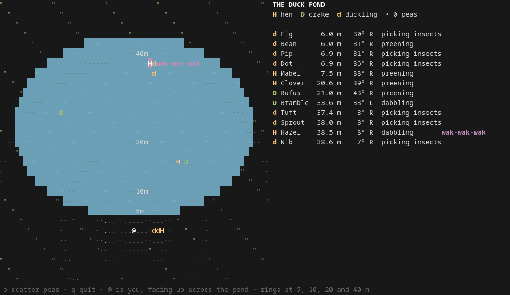

# duck-pond

High-quality duck audio synthesizer.



## Ducks and their sounds

The pond holds a small flock of mallards: three hens (Mabel, Clover and
Hazel), a drake escorting his mate (Rufus, with Clover), a lone drake
(Bramble), and two broods of ducklings following Mabel and Hazel.

### Behaviours

Ducks spend their time much as real mallards do, in bouts lasting minutes:
about 40 % feeding, 30 % resting, 15 % preening and the rest getting about.

| Behaviour | What happens |
| --- | --- |
| Swimming / waddling | Heading to a new spot on the pond or the bank, below hull speed. Hens with young call them together first, then go at a pace the ducklings can keep up with. |
| Dabbling / grazing | Feeding in place: pottering about one spot and sieving the surface in spells. |
| Resting | Loafing on the water or the bank. A sleeping duck rarely calls. |
| Preening | Usually what a duck does once it wakes up. |
| Following | Ducklings swim in a line behind their mother and gather round her when she stops. A drake keeps a little behind his mate. Followers usually copy their leader, but not always: ducklings may feed while their mother rests, and a drake may keep watch while his mate feeds. |
| Straying | Now and then a feeding duckling wanders off after insects. Once it is more than 4 m from its mother, it stops and peeps until she calls it back. |
| Answering | A hen's quack series can set off nearby ducks, and her mate is the most likely to answer. Quiet and busy spells spread from duck to duck, so the pond goes through lively and drowsy stretches. |
| Feeding on peas | Press `p` in `--visualize` mode to throw a handful of peas. The nearest ducks notice them first, call, and race from pea to pea. Once the peas are gone, they go back to what they were doing. |

### Sounds

| Sound | Who | When |
| --- | --- | --- |
| **quack** | Hen | A single call. |
| **quack quack** | Hen | A series of 2–3 evenly spaced quacks that other ducks may answer. |
| **QUACK quack quack** | Hen | The classic decrescendo: 5–7 quacks that get shorter, quieter and lower. |
| **wak-wak-wak** | Hen | Quick, quiet quacks in irregular bursts while feeding. |
| **kwek-kwek** | Hen | Short, soft notes about 3.7 times a second, to gather her brood or call back a lost duckling. |
| **rhaeb** | Drake | A soft, raspy call made of 1–3 rhaebs, given more often when his mate is out of reach. |
| **peep peep** | Duckling | Loud, falling distress whistles, given only when lost. |
| **pip-pip** | Duckling | Soft, short, rising contact notes. |
| Dabbling | Hen, drake | A fast patter of tiny splashes, with the odd bubble. |
| Pecking | Any | A flurry of bill clacks (with splashes on the water), then a swallow. |
| Pea landing | — | A plip on the water or a dull tap on the bank. |
| Water | — | Small bubbles and drips (mostly along the near shore), and water lapping at the bank by the listener. |

## How the sound is made

No samples are used. Every sound is synthesized when it happens, then placed
in space according to where its duck is at that moment.

```
 scene thread                                              audio thread
┌──────────────────────────────────────────────────────┐   ┌──────────────┐
│ simulate ducks ─► synthesize call ─► voice           │   │              │
│                                        │             │   │  cpal output │
│      spatialize each block ◄───────────┘             │──►│  callback    │
│        │ direct (per ear)        │ reverb send       │   │              │
│        ▼                         ▼                   │   └──────────────┘
│       mix ◄──────────────── reverb ◄── water bed     │   bounded queue of
│        └─► master ─► fade-in ─► soft limiter         │   512-frame chunks
└──────────────────────────────────────────────────────┘
```

### 1. Simulation (`scene.rs`)

A background thread advances the pond in 512-frame blocks. In each block,
every duck *thinks* (chooses an activity and a target), *steers* (paddles
towards the target, slides along the shore and keeps clear of other adults),
and *calls* when its call timer runs out. Each call is rendered in full by the
synthesizer and becomes a **voice**: a buffer of samples linked to its duck,
so the sound follows the duck as it moves.

### 2. Call synthesis (`synth.rs`)

Quacks and rhaebs use a **source-filter model** of the duck's syrinx and
vocal tract:

- **Source:** a train of Gaussian-derivative air pulses, one per vibration of
  the syrinx, placed at fractional sample positions. Each call shapes it with
  a pitch contour and an amplitude envelope, and adds random variation:
  - *Jitter* varies the period of each pulse.
  - *Shimmer* varies the amplitude of each pulse.
  - *Period doubling* makes every other pulse weaker and slightly early, which
    adds a subharmonic and produces the quack's rasp.
  - *Pulse width* sets brightness: narrower pulses sound brighter.

  Highpassed breath noise is mixed in. In a rhaeb, each pulse trails off into
  gated hiss.
- **Filter:** a chain of formant resonances, each a peaking-EQ biquad whose
  pole bandwidth matches the formant's bandwidth, so the boosts add up in dB.
  Formant frequencies are updated every 64 samples, following the bill as it
  opens on "qu-" and closes on "-ck".
- **Cleanup:** Butterworth highpass and lowpass filters (designed the same way
  as `scipy.signal.butter`, as cascaded second-order sections) trim the band,
  and the call is normalized to its peak.

Pitch, envelope and rasp contours are built from `smoothstep` ramps plus
*wobble*: smooth random curves made by cosine-interpolating Gaussian knots.
This keeps any two calls from sounding identical.

Other sounds use simpler models:

| Sound | Model |
| --- | --- |
| Peep | A sine with weak 2nd and 3rd harmonics, gliding up, holding, then sweeping down (or up for contact notes). |
| Bubble / plip | A short decaying sine that rises in pitch. |
| Splash | A burst of bandpassed noise (900–6000 Hz) with an exponential decay. |
| Bill clack | A noise impulse ringing through two formants at the hollow of the bill. |
| Gulp | A low blip that drops quickly in pitch. |
| Tap | A very short click of bandpassed noise. |

Longer calls such as the decrescendo, chatter, drake series, peeping and
brood calls lay out single notes on a timeline. Each note gets slightly
varied timing, pitch, formants, rasp and gain.

### 3. Spatialization

The listener stands on the bank facing the pond. A voice reaches them after
the time sound takes to travel the distance (343 m/s). In every block, each
voice is placed according to its duck's current position:

- **Distance:** level falls off as 1/r beyond 2 m. A one-pole lowpass dulls
  distant sounds, with its cutoff chosen to match ISO 9613-1 air absorption
  at 4 kHz; it follows the absorption closely from 2 to 8 kHz. Sounds
  from behind are dulled a little more, shaded by the head.
- **Speakers:** constant-power panning by bearing.
- **Headphones (`--headphones`):** a spherical head model (Brown & Duda,
  1998). Each ear gets its own fractional delay (Woodworth interaural time
  difference, read with Catmull-Rom interpolation) and its own high-frequency
  boost or cut around the head, while low frequencies pass unchanged.
- Gains, delays and filter coefficients are interpolated across each block,
  so moving ducks don't cause zipper noise.

### 4. Mix bus

- **Reverb:** every voice also feeds a shared reverb, a small, dark
  Freeverb-style design (four damped combs and two allpasses per channel,
  with offset lengths for stereo spread). The reverb send falls off with
  distance more slowly than the direct sound, so far ducks sound wetter.
- **Water bed:** noise bandpassed to 90–700 Hz with a slow random swell,
  decorrelated between the two channels.
- **Output stage:** a master gain, a half-second fade-in at startup, and a
  soft limiter (transparent below 0.7, then `tanh` towards 1).

### 5. Playback (`main.rs`)

Rendered chunks go into a bounded queue (8 chunks, about 85 ms at 48 kHz) that
a `cpal` output callback drains, converting to the device's sample format and
mixing down to mono if needed. The pond renders at the device's sample rate,
which must be at least 16 kHz. With `--visualize`, the scene thread also
records a snapshot per block, tagged with its output frame. The terminal map
(`visual.rs`) shows each snapshot when that frame is actually played, so what
you see stays in step with what you hear.
